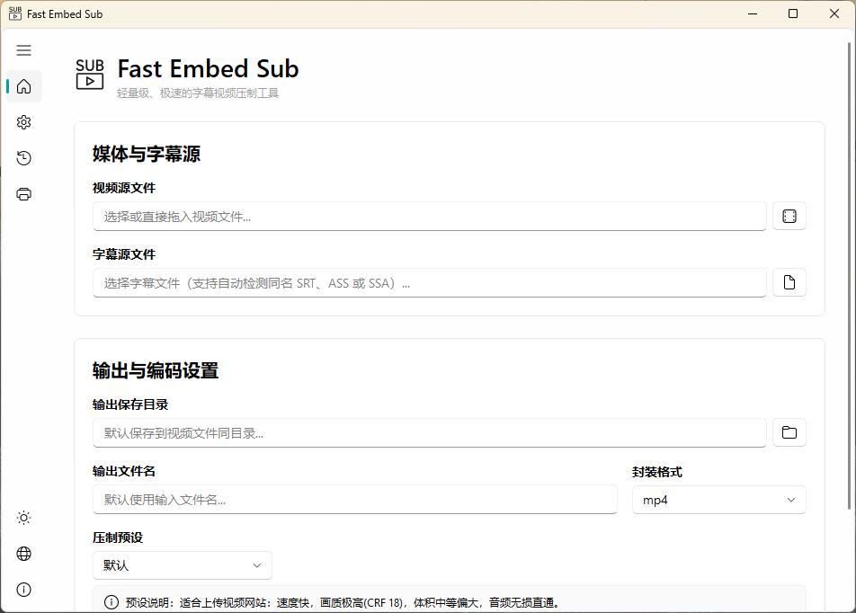
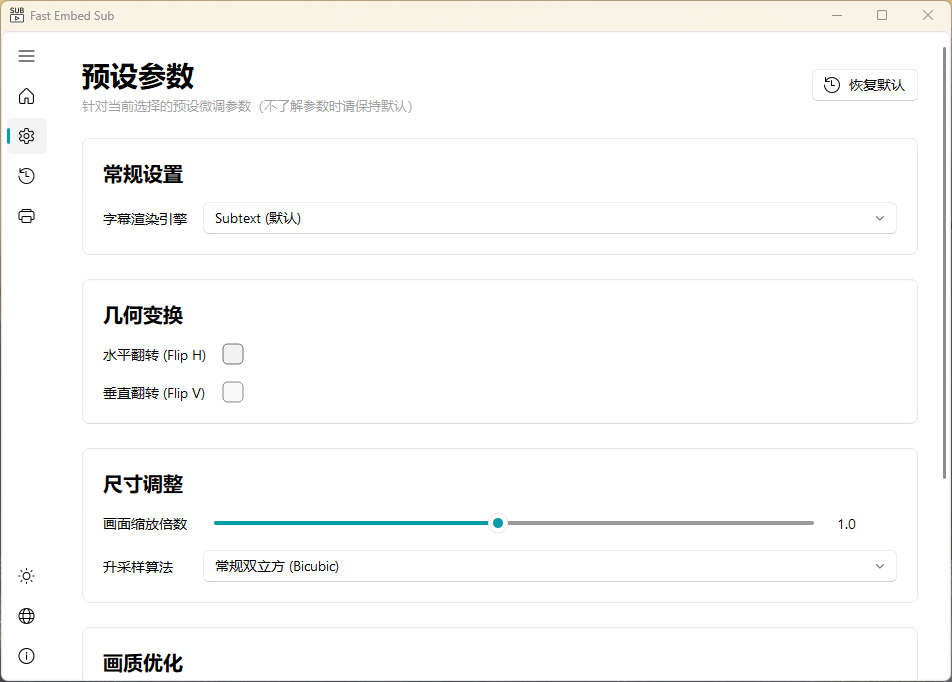

[简体中文](README.md) | English README

<p align="center">
  
</p>

# Fast Embed Sub

Fast Embed Sub is a lightweight video subtitle embedding and transcoding tool. Built on **PySide6** and **FFmpeg**, it combines a Fluent-style interface with drag-and-drop input and reusable encoding presets to burn subtitles into videos and transcode media.

**Currently supports 64-bit Windows only.** Packaged builds do not require a separate Python installation.

**[Download the latest release](https://github.com/Jeoitim/fast-embed-sub/releases/latest)** · [All releases](https://github.com/Jeoitim/fast-embed-sub/releases)

## Screenshots

### Media, subtitles, and output settings



### Preset parameters



## Download and Installation

Open [GitHub Releases](https://github.com/Jeoitim/fast-embed-sub/releases/latest) and expand **Assets** at the bottom of the release page. The current v1.0.1 release provides these files:

| Distribution | Files to download | Instructions |
| --- | --- | --- |
| Installer (recommended) | [FastEmbedSub_v1.0.1_Setup.exe](https://github.com/Jeoitim/fast-embed-sub/releases/download/v1.0.1/FastEmbedSub_v1.0.1_Setup.exe) | Includes the application and runtime components. Follow the setup wizard. |
| Portable | [FastEmbedSub_v1.0.1_Portable-Core.7z](https://github.com/Jeoitim/fast-embed-sub/releases/download/v1.0.1/FastEmbedSub_v1.0.1_Portable-Core.7z) **and** [FastEmbedSub_v1.0.1_Portable-Components.7z](https://github.com/Jeoitim/fast-embed-sub/releases/download/v1.0.1/FastEmbedSub_v1.0.1_Portable-Components.7z) | Download both archives and combine them as described below. |

### Installer

1. Download `FastEmbedSub_v1.0.1_Setup.exe`.
2. Run it and follow the wizard to select an installation folder. Allow administrator access when prompted.
3. Launch **FastEmbedSub** from the desktop or Start menu shortcut. The installer includes runtime components; no separate Core or Components download is needed.

### Portable

1. Download `Portable-Core.7z` and `Portable-Components.7z` from the **same release**. Use an extraction tool that supports `.7z` archives.
2. Extract Core first. It creates the `FastEmbedSub_v1.0.1_Portable-Core` folder containing `FastEmbedSub.exe`, presets, interface assets, and FFmpeg.
3. **Extract the Components archive into the `components` folder beside `FastEmbedSub.exe`.** The archive contains a `vapoursynth` folder directly. If extracted separately, copy that folder into `components`.
4. Confirm that `components/vapoursynth/vspipe.exe` exists, then launch `FastEmbedSub.exe`.

The combined directory should look like this. Keep the other files included in Core:

```text
FastEmbedSub_v1.0.1_Portable-Core/
├── FastEmbedSub.exe
├── assets/
├── i18n/
├── presets/
└── components/
    ├── ffmpeg.exe
    └── vapoursynth/
        ├── vspipe.exe
        └── ...
```

Do not put `vapoursynth` at the application root or nest it inside an extra `Portable-Components` folder. Missing Components prevents subtitle rendering and processing features that depend on VapourSynth from working.

**Source code (zip / tar.gz)** contains source files. For normal use, download the installer or both portable archives listed above.

---

## 📖 For Regular Users: Quick Start

If you just want to transcode videos and embed subtitles, Fast Embed Sub is designed for simplicity:

### Key Features

* 🎛️ **Drag-and-Drop**: Simply drag files or directories directly onto the UI inputs. No file-explorer navigation needed.
* 🔍 **Auto-Association**: When you load a video, the software automatically scans for subtitles (`.srt` / `.ass` / `.ssa`) with the same name in the same directory.
* ⚡ **Task Queue**: Add multiple transcoding tasks to the queue and let the background queue process them sequentially without freezing the UI.
* 📝 **Real-Time Log & Progress**: A visual progress bar along with raw stderr/stdout outputs from FFmpeg allows you to monitor encoding details.

### How to Use

1. **Download and Launch**: Follow the installer or portable instructions above, then launch Fast Embed Sub.
2. **Choose Source Files**: Drag your video into the input box. If matching subtitles exist, they will be loaded automatically.
3. **Select Preset**: Choose a preset from the dropdown (e.g., "Default", "Fast", or "Social Media").
4. **Add to Queue**: Click "Add to Queue". Transcoding starts automatically in the background. You can check status and cancel tasks in the "Queue" tab.

---

## 💡 For Geeks and Encoders: Modular Preset Ecosystem

Fast Embed Sub's primary design goal is its **modular preset sharing model** coupled with a new **portable VapourSynth post-processing pipeline**.

### 1. Why Modular Preset Sharing?
Video encoding requires a deep understanding of FFmpeg parameters and endless test cycles to achieve the perfect size-to-quality balance.
With Fast Embed Sub, geeks can package optimized settings into simple `.txt` files. Users can download these files, place them in the `presets/` folder, and instantly access expert-tuned configurations after restarting the software, making **expert profiles reusable for everyone**.

### 2. Portable VapourSynth (VS) Environment Isolation
In this major upgrade, we introduced a portable VapourSynth post-processing pipeline.
VapourSynth is a Python-based video processing framework that excels in de-banding, de-noising, and super-resolution scaling. To avoid complex local Python setups and version conflicts ("DLL Hell"), we designed a **portable sandbox environment**:

## 🛠️ For Preset Authors: Preset Writing Guide

This software uses a data-driven preset system. Any `.txt` files placed in the `presets/` directory are automatically loaded as encoding preset templates.

For details on how to write custom **FFmpeg command line presets** or advanced **VapourSynth (Vpy) portable presets**, please refer to our comprehensive guide:

👉 **[预设文件编写指南 (简体中文)](presets/document.md)**
👉 **[Preset Writing Guide (English)](presets/document_en.md)**

---

## 💻 For Developers: Technical Stack & Architecture

Refer to these guidelines if you want to inspect, modify, or compile Fast Embed Sub.

### 1. Technology Stack & Dependencies
* **Language**: Python >= 3.12
* **GUI Framework**: PySide6 (Qt for Python)
* **UI Controls**: [PySide6-Fluent-Widgets](https://github.com/zhiyiYo/PySide6-Fluent-Widgets) (Fluent design controls and dark theme framework)
* **YAML Parser**: PyYAML (to parse preset custom parameter metadata)
* **Compiler/Packager**: Nuitka 4.x (compiles Python code to optimized native executables)

### 2. File Architecture

The core functionality is split across these modules:

* **[main.py](main.py)**: Entry point. Displays the splash screen, asynchronously imports dependencies, applies dark themes, and shows the main window.
* **[preset_parser.py](preset_parser.py)**: Preset parsing engine. Splits YAML parameters, VvapourSynth templates, and command lines. Resolves type-safe parameter values and path slashes.
* **[vpy_param_widget.py](vpy_param_widget.py)**: Dynamic parameter widgets. Renders PySide6 controls dynamically from YAML configurations and handles form value extraction.
* **[gui.py](gui.py)**: Main UI window. Handles drag-and-drop (DragDropLineEdit), controls updates, layout margins, page switching, and preset parameters widget attachments.
* **[engine.py](engine.py)**: Scheduler and transcoding engine.
  * Dispatches `TranscodeTask` objects.
  * Writes compiled temporary `.vpy` scripts.
  * Checks for portable `vspipe.exe`. Sets environment variables (`PATH`, `PYTHONPATH`) on QProcess to run portable VapourSynth without installation dependencies.
  * Spawns `QProcess`. Wraps pipe commands inside `cmd.exe /c` on Windows.
  * Probes video duration to calibrate background task progress calculations, and deletes temporary `.vpy` files after execution.
* **`localization.py` and `i18n/`**: Runtime language management through Qt `QTranslator`. Editable Chinese translations live in `.ts`, while the application loads the compiled `.qm`. The transcoding engine emits structured log events and has no UI-language dependency.

### 3. Local Development
1. **Navigate to the Project**:
   ```bash
   cd fast-embed-sub
   ```
2. **Install Dependencies**:
   We recommend using `uv` to manage package installations:
   ```bash
   uv pip install -r requirements.txt
   ```
3. **Run App**:
   ```bash
   python main.py
   ```
4. **Update UI translations** after changing `self.tr(...)` or `QCoreApplication.translate(...)` text:
   ```powershell
   .venv\Scripts\pyside6-lupdate.exe main.py gui.py localization.py vpy_param_widget.py -ts i18n\fast_embed_sub_zh_CN.ts
   .venv\Scripts\pyside6-linguist.exe i18n\fast_embed_sub_zh_CN.ts
   .venv\Scripts\pyside6-lrelease.exe i18n\fast_embed_sub_zh_CN.ts
   ```
   Commit both `.ts` and `.qm`. Runtime preset extensions remain self-contained through each preset YAML `locales` block.

### 4. Compilation & Packaging (`build.ps1`)

**Cloud builds:** Normal `master` pushes and pull requests run compilation and dependency import checks only. Pushing a `v*` tag builds and uploads a `Portable-Core.7z` artifact. VapourSynth components are not stored in the repository, so GitHub Actions uses `-SkipInstaller` to skip NSIS. Prepare the Setup installer and Components archive locally and upload them to the release page.

Run `./build.ps1 -Version 1.0.1` locally to create the complete installer, or add `-SkipInstaller` to build only the portable application directory.

The repository includes a packaging script [build.ps1](build.ps1) that compiles Qt translations and Python files, syncs assets, presets, and `i18n/` to the output folder, and runs post-build UPX compression on output executables and DLLs.
